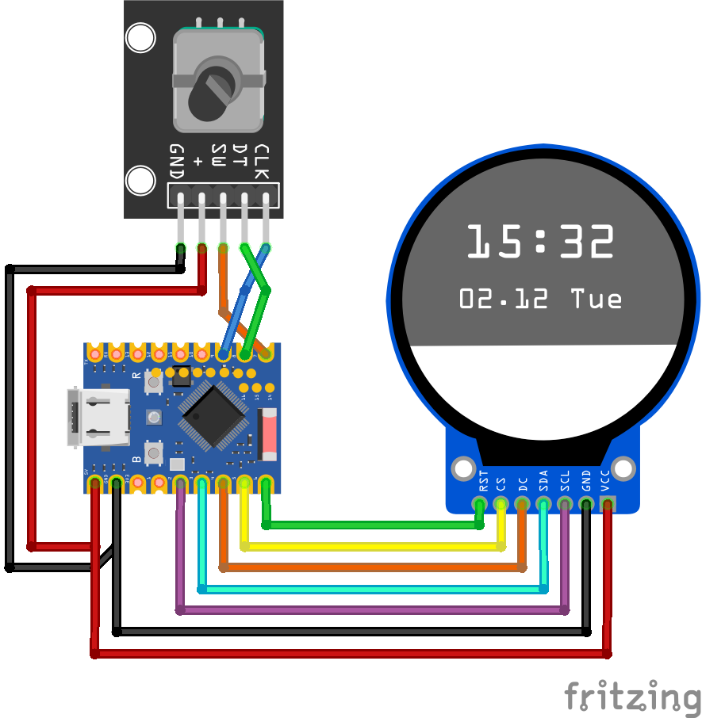
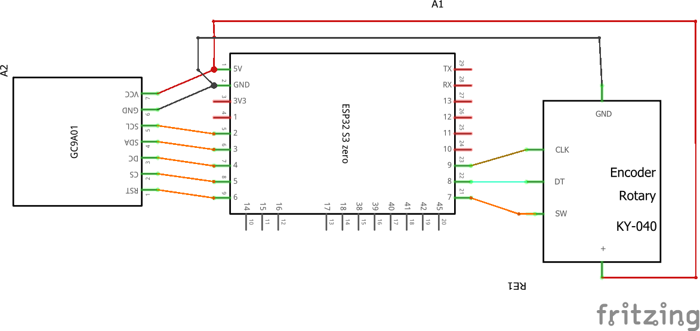

# 📡 Micro Radar
This project is a fork of [Anthony Sturdy's Micro Radar project](https://github.com/AnthonySturdy/micro-radar?tab=readme-ov-file) and adapts it for inexpensive and readily available ESP32 hardware, rather than complex devices.

---
### What's Different?

**This fork adds:**

- ESP32-S3 Zero support
- Round GC9A01 display support
- Rotary encoder navigation
- Aircraft selection and details screen
- Enhanced aircraft icons
- Multi-color aircraft rendering
- Onboard RGB status LED
- Simplified hardware requirements
- OpenStreetMap background map, recoloured into a dark theme on the device
- Web Mercator projection, so aircraft and map line up
- Aircraft type as the details-screen heading, plus route when known
- Registration, owner and climb rate on the details screen
- Spelled-out airport towns alongside the IATA codes where they fit
- Display rotation, backlight and map options in the web panel
- Configurable OpenSky refresh rate, with its credit cost shown live
---
## Hardware

- [ESP32-S3 Zero](https://amzn.eu/d/0a1FAhVQ) (USB-C, 4 MB flash, 2 MB PSRAM). The firmware is built for this board.
- [240×240 round GC9A01 display](https://amzn.eu/d/0c7FremT)
- [KY-040 rotary encoder](https://amzn.eu/d/03BbIKNv)
- 3D printed parts
- Optional: a [single domed mineral watch crystal](https://a.aliexpress.com/_EwDz3CA) (1.5 mm edge thickness, 35.5 mm diameter), bonded to the front of the display with [UV resin](https://amzn.eu/d/0gbuFWd9)

### Power

The only power connector is the USB-C socket on the ESP32-S3 Zero. The same socket is used to flash the board.

- Flashing needs a USB-C cable that carries data, plugged into the PC. A charge-only cable powers the board and never shows a serial port.
- After flashing, that same USB-C socket runs from any 5 V USB charger. A normal phone charger is enough.
- The display and the encoder are powered from the board's 3.3 V pin, as in the wiring tables below. Do not connect either module's supply pin to 5 V.

---

## Wiring

### GC9A01 240x240 Round Display
| ESP32-S3 Zero | Display |
|----------|----------|
|GP2|SCL |
|GP3|SDA |   
|GP4|DC |   
|GP5|CS |   
|GP6|RST |   
|GP1|BLK |   
|3V3|VCC |   
|GND|GND |   

> The AZDelivery GC9A01 module is specified for 3.3 V on both logic and supply — do not connect VCC to 5V.
> BLK is driven by PWM, so the brightness can be controlled in software.

### KY-040 Rotary Encoder

| ESP32-S3 Zero | KY-040 |
|---|---|
| GP9 | CLK |
| GP8 | DT |
| GP7 | SW |
| 3V3 | + |
| GND | GND |

---




---
## Build and flash (Windows 11)

PlatformIO Core builds the firmware and uploads it over the board's USB-C port. Visual Studio Code is not required. A browser-based flasher for the original project will not install this firmware.

Use a USB-C cable that carries data. A charge-only cable powers the board and never shows a serial port.

### 1. Install Python

1. Download Python 3.11 or newer from [python.org](https://www.python.org/downloads/windows/).
2. Run the installer and enable **Add python.exe to PATH**.
3. Close every open terminal, then open a new PowerShell or Command Prompt window so the updated PATH is picked up.

Check the install:

```
python --version
```

### 2. Install PlatformIO Core

```
python -m pip install --upgrade platformio
```

The first build later downloads the ESP32 toolchain. That needs an internet connection and can take several minutes.

### 3. Get the project

Download this repository as a ZIP and extract it, or clone it with Git. Either way, open a terminal in the extracted project directory — the folder that contains `platformio.ini`. In File Explorer, Shift+right-click that folder and choose **Open in Terminal**.

### 4. Upload

Connect the ESP32-S3 Zero, then run:

```
pio run -t upload
```

If Windows says `pio` is not recognized, call PlatformIO through Python instead. The two commands do the same thing:

```
python -m platformio run -t upload
```

PlatformIO picks the COM port on its own when only one board is plugged in.

To watch the serial log (115200 baud):

```
pio device monitor
```

Leave the monitor with `Ctrl+C`. Close it before the next upload, or the port stays busy.

### If the board is not detected

1. Try another USB port, preferably one on the PC itself.
2. Hold **BOOT**, tap **RESET**, release **BOOT**, then run the upload again. The ESP32-S3 Zero often needs that the first time.
3. In Device Manager, look under **Ports (COM & LPT)** for a USB serial device. Windows 11 already includes a driver for the board's built-in USB port, so a missing port is usually the cable, BOOT mode, or a different board than the ESP32-S3 Zero.

### Optional: Visual Studio Code

If you would rather click a button than type the commands, install [Visual Studio Code](https://code.visualstudio.com/) and the **PlatformIO IDE** extension, then open the project directory. The extension installs PlatformIO Core for you, so you can skip the `pip` step above and use **Upload** on the PlatformIO toolbar. The commands in this guide still work from VS Code's terminal.

### First start

1. Power the board. On first boot the display shows the Wi-Fi name **MicroRadar-Setup**.
2. Join that network from a phone or PC. It is an open hotspot.
3. The setup page should open on its own. If it does not, browse to `http://192.168.4.1/`.
4. Enter your Wi-Fi name and password and save. The device restarts and joins that network.
5. Open the configuration panel at `http://microradar.local/`. If that name does not resolve, the serial log prints the IP address to use instead.


---

## Configuration

The device serves a configuration panel on port 80. Open it at `http://microradar.local/`, or at the IP address the device prints to the serial log after connecting.

| Option | Meaning |
|---|---|
| Latitude, Longitude | Centre of the view |
| Radius | Half of the visible height in degrees. It is snapped to the next whole tile zoom level; the panel shows the resulting zoom and effective radius |
| Map background | Turns the map off. Nothing is downloaded when it is off |
| Dark filter | Recolours the tiles into the dark theme. Off shows the original OpenStreetMap colours, which makes the green aircraft hard to see unless you also lower the brightness |
| Map brightness | Dims the map, so aircraft and the radar sweep stay on top |
| Reload map now | Fetches the tiles again, bypassing the cache, without changing any setting |
| Backlight | Panel brightness over the BLK pin |
| Rotate by 180 degrees | For mounting the display upside down, e.g. to suit the cable routing |
| Radar sweep, Radar circles, Aircraft Info, Directional Aircraft | Radar overlay options |
| Aircraft details | Which rows the details screen shows. Type, route and registration are only requested when at least one of the three is on. Every row costs vertical space inside the round frame, so turning all of them on pushes the last one into the bezel |
| Airport names | Adds the towns the airports serve to the route row, as `Barcelona (BCN) > Munich (MUC)`. Needs Route on. A route too long for one row drops the codes first and then the towns, since a shortened town name is worth less than either |
| Climb rate | Vertical speed, amber climbing and cyan descending |
| OpenSkyAPI Client ID / Secret | Credentials for the OpenSky Network API |
| Aircraft refresh | Seconds between OpenSky requests, or 0 to spread the daily allowance evenly over 24 hours. The panel shows what the chosen rate costs per day of uptime and how long the allowance lasts at that rate |

Saving restarts the device, because position, radius, filter and brightness all change the map that is fetched once at boot.

### OpenSky credits

OpenSky rations its API by daily credits rather than by rate: 4000 with credentials, 400 without, resetting at midnight UTC. Three are held back for the access token, which lasts 29 minutes and costs credits of its own.

The automatic setting divides the day by the remaining allowance, which comes to one request every 22 seconds authenticated and every 217 seconds anonymous. A faster rate is allowed, because a radar that is only switched on in the evening can afford one the clock could not: 5 seconds costs 17280 credits per full day, but only 2160 over four hours. Once the allowance is gone the feed stops answering until the reset, so the panel spells out how many hours the chosen rate lasts. The floor is 5 seconds, below which OpenSky has no new position to give.

The finished map is cached in LittleFS as `/map.raw`, so a restart usually shows it after about 40 ms instead of downloading four tiles again. The cache is dropped when the view or the look changes, or once it is older than seven days.

---
### Credits

https://github.com/AnthonySturdy/micro-radar

Many thanks to Anthony Sturdy for creating and open-sourcing the original project that made this fork possible.

### Aircraft type and route data

OpenSky state vectors carry neither the aircraft type, the registration nor the route, so the details screen resolves the selected aircraft against [adsbdb](https://www.adsbdb.com/). No API key is needed and the requests do not count against the OpenSky budget. Only the aircraft currently shown is looked up, and every answer is cached until the device restarts.

Where adsbdb has no entry for an airframe, the type, registration and owner are looked up at [hexdb.io](https://hexdb.io/), which closes about half of those gaps. Neither database knows every aircraft, and for the remainder the operator derived from the callsign takes the place of the type.

Names from a worldwide database carry accents the display font has no glyphs for, so the accented Latin letters are folded onto their base letter: Zürich reaches the display as Zurich rather than losing the letter altogether.

The flight route data is the work of David Taylor, Edinburgh and Jim Mason, Glasgow, and may not be copied, published, or incorporated into other databases without the explicit permission of David J Taylor, Edinburgh. Aircraft data comes from Planebase.

### Map data

Map data (c) [OpenStreetMap contributors](https://www.openstreetmap.org/copyright), available under the Open Database Licence. Tiles are fetched from `tile.openstreetmap.org` under the [Tile Usage Policy](https://operations.osmfoundation.org/policies/tiles/): only the tiles for the configured viewport are requested, the result is cached locally with a seven day lifetime, and the firmware identifies itself with its own User-Agent. Spotted a mistake in the map? [Report it here](https://www.openstreetmap.org/fixthemap).
